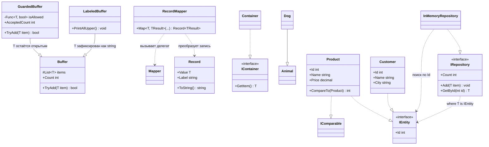

# DataFlow — обобщения в C#

## 1. Назначение проекта

**DataFlow** — небольшая переиспользуемая библиотека для хранения, поиска, преобразования и вывода типизированных данных без дублирования кода для разных типов.

Решение демонстрирует четыре темы C#: иерархии обобщённых классов, обобщённые структуры и делегаты, обобщённые интерфейсы с ограничениями и ковариантностью, а также методы расширения.

В отчёте используется предметная область **складского учёта**: товар (`Product`) и клиент (`Customer`). Это первый вариант из задания. Для проверки ковариантности дополнительно используются `Animal` и `Dog`.

## 2. Состав решения

Решение состоит из двух проектов:

- **`DataFlow.Core`** — универсальное ядро. Оно содержит обобщённые классы, структуру, делегат, интерфейсы, репозиторий и методы расширения. Ядро не должно зависеть от конкретных классов предметной области.
- **`DataFlow.Demo`** — консольное приложение, где объявлены предметные типы и собран сценарий, демонстрирующий работу ядра.

Файл решения `DataFlow.sln` объединяет оба проекта. `DataFlow.Demo` ссылается на `DataFlow.Core`; без этой ссылки демонстрационное приложение не сможет использовать типы библиотеки.

### Основные файлы

| Файл | Назначение |
|---|---|
| `DataFlow.Core/Buffer.cs` | Базовый обобщённый буфер `Buffer<T>` |
| `DataFlow.Core/LabeledBuffer.cs` | Наследник `Buffer<string>` с выводом строк в верхнем регистре |
| `DataFlow.Core/GuardedBuffer.cs` | Обобщённый наследник с проверкой допуска и счётчиком принятых элементов |
| `DataFlow.Core/Record.cs` | `Record<T>`, делегат `Mapper<T, TResult>` и обобщённый метод `Map` |
| `DataFlow.Core/Contracts.cs` | Контракты `IEntity`, `IRepository<T>` и ковариантный `IContainer<out T>` |
| `DataFlow.Core/InMemoryRepository.cs` | Хранение сущностей и поиск по `Id` |
| `DataFlow.Core/Container.cs` | Реализация `IContainer<T>` |
| `DataFlow.Core/CollectionExtensions.cs` | Методы расширения `PrintAll` и `FindMax` |
| `DataFlow.Demo/Domain.cs` | Типы `Product`, `Customer`, `Animal`, `Dog` |
| `DataFlow.Demo/Program.cs` | Единый демонстрационный сценарий |
| `DataFlow.Demo/ExpectedErrors.cs` | Место для временных примеров ошибок компиляции; ошибочные фрагменты следует держать закомментированными в финальной версии |

## 3. Схема классов и интерфейсов



`LabeledBuffer` фиксирует параметр типа как `string` и сам уже не является обобщённым классом. `GuardedBuffer<T>` передаёт открытый параметр `T` базовому классу и остаётся универсальным. В `IContainer<out T>` тип используется только в возвращаемой позиции, что разрешает ковариантное преобразование интерфейса.

## 4. Реализация предметной области

`Product` реализует два контракта:

- `IEntity` — предоставляет `Id`, по которому `InMemoryRepository<T>` может найти объект;
- `IComparable<Product>` — задаёт правило сравнения товаров. В примере товары сравниваются по `Price`, поэтому `FindMax()` возвращает товар с наибольшей ценой.

`Customer` реализует `IEntity`, так как клиентам нужен идентификатор и поиск по нему, но не реализует `IComparable<Customer>`: в демонстрации клиентов не требуется сравнивать для поиска максимума.

`ToString()` у `Product` и `Customer` переопределён, чтобы методы вывода показывали содержательные сведения, а не стандартное имя типа. `Animal` и `Dog : Animal` нужны только для демонстрации ковариантности.

## 5. Как запустить

Требования из задания: Visual Studio 2026 и .NET 10 SDK.

Из каталога, где находится `DataFlow.sln`, выполните:

```bash
dotnet build --configuration Release
dotnet run --project DataFlow.Demo --configuration Release
```

Финальная сборка должна завершаться без ошибок и предупреждений. Для сохранения вывода в файл можно использовать:

```bash
dotnet run --project DataFlow.Demo --configuration Release > output.txt
```

Примеры трёх ожидаемых ошибок приведены ниже текстом. Их назначение — проверить работу компилятора; не оставляйте ошибочные фрагменты активными одновременно с финальной сборкой.

## 6. Ответы на вопросы по шагам

### Шаг 0. Подготовка решения

**1. Зачем в решении два проекта, а не один?**  
`DataFlow.Core` содержит универсальные компоненты, которые можно использовать в других приложениях. `DataFlow.Demo` содержит типы конкретной предметной области и демонстрационный код. Такое разделение не позволяет ядру зависеть от `Product` или `Customer` и подтверждает переиспользуемость библиотеки.

**2. Что произойдёт, если убрать `dotnet add reference`?**  
`DataFlow.Demo` перестанет ссылаться на `DataFlow.Core`. Компилятор не сможет разрешить имена типов библиотеки, например `Buffer<T>`, и проект не соберётся.

**3. Почему проект библиотеки нельзя запустить, а консольный — можно?**  
Библиотека классов предназначена для подключения к другому проекту и обычно не имеет точки входа. Консольный проект содержит запускаемый код — в шаблоне это точка входа приложения, — поэтому `dotnet run` может выполнить его.

### Шаг 1. Обобщённый базовый класс `Buffer<T>`

**1. Чем `protected` отличается от `private` и от `public` для поля `items`?**  
`protected` разрешает обращаться к полю внутри `Buffer<T>` и его наследников, но не из произвольного внешнего кода. `private` ограничил бы доступ самим классом `Buffer<T>`, поэтому `LabeledBuffer` не смог бы перечислять элементы. `public` открыл бы внутренний список всем вызывающим объектам и позволил бы менять состояние в обход методов буфера.

**2. Что означает `readonly` и запрещает ли оно добавлять элементы?**  
`readonly` запрещает повторно присвоить полю другую ссылку после инициализации. Оно не делает сам список неизменяемым: вызывать `items.Add(...)` по-прежнему можно.

**3. Зачем `TryAdd` возвращает `bool`, если сейчас всегда возвращает `true`?**  
Результат описывает, был ли элемент принят. В базовой версии добавление всегда успешно, но наследник `GuardedBuffer<T>` может отклонять элементы и возвращать `false`. Такой контракт позволяет вызывающему коду проверить результат без обязательного исключения.

**4. Что произойдёт, если убрать `virtual`?**  
`GuardedBuffer<T>` не сможет корректно переопределить метод с помощью `override`; компилятор выдаст ошибку. `virtual` явно разрешает производным классам заменить поведение метода.

**5. Чем `new()` отличается от `new List<T>()`?**  
В данном контексте это две формы создания одного и того же списка. `new()` — сокращённая форма создания, тип выводится из объявленного поля `List<T>`; `new List<T>()` явно указывает тип.

### Шаг 2. Наследование с фиксацией типа — `LabeledBuffer`

**1. Чем `LabeledBuffer : Buffer<string>` отличается от `GuardedBuffer<T> : Buffer<T>`?**  
`LabeledBuffer` не объявляет параметр типа и жёстко фиксирует тип базового буфера как `string`. `GuardedBuffer<T>` оставляет `T` открытым и передаёт его базовому классу, поэтому с ним можно работать с разными типами.

**2. Почему `PrintAllUpper()` нельзя было написать в `Buffer<T>`?**  
В `Buffer<T>` компилятор не знает, что произвольный `T` содержит метод `ToUpper()`. После фиксации `T = string` в `LabeledBuffer` такой вызов типобезопасен.

**3. Что случится при попытке объявить `LabeledBuffer<int>`?**  
Код не скомпилируется: `LabeledBuffer` сам не является обобщённым типом и не принимает аргумент типа.

**4. Смог бы такой буфер хранить числа при наследовании от `Buffer<object>`? Что это означало бы для типовой безопасности?**  
Список `List<object>` может хранить объекты разных типов, в том числе упакованные значения числовых типов. Однако метод `PrintAllUpper()` нельзя оставить в исходном виде: элемент цикла имел бы тип `object`, у которого нет `ToUpper()`. Пришлось бы проверять тип или приводить значения к строкам. Кроме того, буфер потерял бы гарантию, что в нём находятся только строки: смешанные значения пришлось бы обрабатывать отдельно.

### Шаг 3. Переопределение с сохранением обобщённости — `GuardedBuffer<T>`

**1. Почему проверка отказа стоит до вызова базового метода?**  
Если элемент не прошёл `isAllowed`, его нужно отклонить до помещения в список. Ранний `return false` гарантирует, что базовый `TryAdd` не добавит запрещённое значение.

**2. Что произойдёт, если увеличивать `AcceptedCount` до проверки результата базы?**  
Счётчик может увеличиться даже тогда, когда элемент в действительности не был добавлен. Счётчик будет отражать число попыток или прошедших фильтр элементов, а не число успешных добавлений.

**3. Чем отличается `GuardedBuffer<int>` от `GuardedBuffer<string>`, если код класса один?**  
У экземпляров разные типы данных и разные переданные делегаты проверки. В примере числа должны быть больше нуля, а строки — не быть `null`, пустыми или состоящими из пробелов. Универсальная реализация одна, правила задаются вызывающим кодом.

**4. Почему нельзя заменить `base.TryAdd(item)` на `items.Add(item)`, даже если сейчас результат тот же?**  
Прямое добавление продублировало бы базовую логику и обошло бы возможные будущие проверки в `Buffer<T>.TryAdd`. Вызов `base.TryAdd(item)` повторно использует реализацию базового класса, а `added` позволяет учитывать её фактический результат.

**5. Что изменится, если перенести условие отказа внутрь класса вместо передачи через конструктор?**  
Класс станет менее гибким: правило будет зашито в его код и не сможет свободно задаваться для разных типов и сценариев. Переданный через конструктор `Func<T, bool>` позволяет выбрать политику допуска снаружи, не меняя библиотеку.

### Шаг 4. Обобщённая структура, делегат и метод

**1. Чем `struct` отличается от `class` для вызывающего кода?**  
Структура является типом значения: при обычном присваивании копируется её значение. Класс — ссылочный тип: переменные обычно содержат ссылку на один объект. `Record<T>` объявлен как `readonly struct`, поэтому его данные после создания нельзя изменить через свойства.

**2. Что выведет `Console.WriteLine(record)`, если не переопределять `ToString()`?**  
Будет использовано стандартное строковое представление типа, например имя `Record` вместе с обобщённым аргументом, вместо удобного содержимого записи. Конкретный вид имени зависит от пространства имён и представления среды выполнения.

**3. Как компилятор понял, что `TResult` равен `string` во втором вызове?**  
Он вывел тип результата из лямбда-выражения, переданного в `Map`: выражение `c >= 15 ? "тепло" : "холодно"` возвращает строку. Поэтому при этом вызове `T = double`, а `TResult = string`.

**4. Почему не использовать отдельные методы `ToFahrenheit` и `ToCategory` без обобщения?**  
Такие методы возможны, но каждый реализовывал бы отдельный конкретный сценарий. Обобщённый `Map<T, TResult>` отделяет механизм преобразования записи от конкретной операции и позволяет использовать его для `double → double`, `double → string`, `int → int`, `int → bool` без копирования логики.

**5. Что будет, если убрать `ToString()` и заметит ли это проверяющий?**  
При выводе записи вместо метки и значения появится стандартное представление типа. Это видно в демонстрационном выводе, поэтому назначение переопределения легко проверить.

### Шаг 5. Обобщённые интерфейсы и ограничение типа

**1. Что произойдёт, если убрать `where T : IEntity` и написать тело методов репозитория?**  
В обобщённом коде нельзя будет обратиться к `item.Id`: для произвольного `T` компилятор не знает о таком свойстве. Ограничение гарантирует наличие контракта `IEntity` у каждого допустимого аргумента типа.

**2. Почему ограничение проверяет компилятор, а не программа во время выполнения?**  
Параметр типа известен компилятору при использовании закрытого обобщённого типа. Проверка заранее исключает недопустимые комбинации и позволяет компилятору разрешить вызовы членов `IEntity` без динамических проверок во время работы.

**3. Что означает `T?` в `GetById` и чем оно отличается от `Nullable<T>` для значимых типов?**  
`T?` обозначает, что результат может представлять отсутствие значения; это нужно, потому что запись с данным `Id` может не найтись. `Nullable<T>` — отдельная конструкция для значимых типов, например `int?`. Здесь `T` ограничен интерфейсом `IEntity` и может быть ссылочным типом или структурой, реализующей интерфейс, поэтому `T?` не следует просто приравнивать к `Nullable<T>` для всех вариантов `T`.

**4. Что произойдёт, если добавить `void Put(T item)` в `IContainer<out T>`?**  
Компилятор выдаст ошибку вариативности (в задании приводится `CS1961`). `out T` допускает использование `T` только в выходной позиции; параметр метода является входной позицией.

### Шаг 6. Реализация репозитория в памяти

**1. Почему `where T : IEntity` нужно указывать и на интерфейсе, и на реализации?**  
Ограничение интерфейса сообщает требование его контракту. Реализация также должна объявить это ограничение, чтобы компилятор знал, что внутри `InMemoryRepository<T>` допустимо читать `item.Id` и что каждый используемый тип удовлетворяет контракту.

**2. Что означает `return default;` для ссылочного типа и для `int`?**  
`default` возвращает стандартное значение соответствующего типа. Для ссылочного типа это `null`, для `int` — `0`. В данном репозитории `T` должен реализовывать `IEntity`, поэтому `int` не может быть непосредственным аргументом `T`, но пример с `int` показывает общее правило `default`.

**3. Что будет, если вернуть `null`, когда `T` может быть структурой? Какой код ошибки указан в задании?**  
`null` нельзя вернуть для произвольного значимого типа `T`. В задании для этого случая указан код `CS0403`. `default` подходит и для ссылочных, и для значимых типов.

**4. Почему `items` здесь `private`, а в `Buffer<T>` было `protected`?**  
`InMemoryRepository<T>` не предоставляет наследникам требований к доступу к внутреннему списку. Поле является деталью реализации, а внешние операции должны выполняться через `Add`, `GetById` и `Count`. В `Buffer<T>` доступ наследника к списку специально нужен для реализации `LabeledBuffer`.

### Шаг 7. Ковариантность: класс против интерфейса

**1. Почему `IContainer<Animal>` принимает `Container<Dog>`, а `Container<Animal>` — нет?**  
`Dog` наследуется от `Animal`, а `IContainer<out T>` специально объявлен ковариантным, поэтому `IContainer<Dog>` можно использовать как `IContainer<Animal>`. Сам класс `Container<T>` инвариантен: `Container<Dog>` и `Container<Animal>` — разные закрытые типы, между которыми автоматического преобразования нет.

**2. Какую цену мы платим за `out T`?**  
Интерфейс не может принимать `T` как обычный аргумент метода. Это ограничение сохраняет безопасность: если контейнер отдаётся как контейнер животных, вызывающий код может получать животное, но не должен иметь возможность поместить туда произвольное животное через такой интерфейс.

**3. Зачем `Container<T>` помечен `sealed`, если ковариантность объявлена на интерфейсе?**  
В реализации задания `sealed` запрещает наследование и последующее расширение класса дополнительным поведением, например методом записи значения. Формально ковариантность задаётся контрактом `IContainer<out T>`; `sealed` дополнительно фиксирует реализацию контейнера и не позволяет наследникам расширять её API.

**4. Пример, где `IContainer<Animal>` полезнее `Container<Animal>`.**  
Метод, который лишь читает элемент, может принимать `IContainer<Animal>`. Тогда ему подходят контейнеры с `Dog`, `Cat` и другими наследниками `Animal` без создания или преобразования каждого контейнера в `Container<Animal>`. Код зависит от нужного контракта чтения, а не от конкретной реализации.

### Шаг 8. Методы расширения

**1. Что перестанет работать, если заменить `IEnumerable<T>` на `List<T>`?**  
Метод сможет вызываться только у `List<T>`. Массивы и другие типы, реализующие `IEnumerable<T>`, а также многие результаты запросов LINQ, перестанут подходить, хотя перечислять их можно. `IEnumerable<T>` обеспечивает более широкий контракт.

**2. Зачем в `FindMax` ограничение `where T : IComparable<T>`?**  
Метод использует `CompareTo`, чтобы определить, какой элемент больше. Без ограничения компилятор не может гарантировать наличие `CompareTo` у произвольного `T`, поэтому вызов не будет компилироваться.

**3. Почему нельзя заменить реализацию готовым `Max()` из LINQ?**  
По условию задания пустая последовательность должна вернуть `default(T)`, а не приводить к исключению. Поэтому `FindMax` выполняет проход самостоятельно и отдельно отслеживает, найден ли хотя бы один элемент.

**4. Чем `return default` отличается от `return null` и как это видно по выводу?**  
`default` подходит для разных видов `T`: для ссылочных типов он даёт `null`, а для `int` — `0`. Возврат `null` не подходит универсальному методу, который может обрабатываться со значимым типом. В выводе это видно на пустых коллекциях: `List<string>` даёт `null`, пустой `List<int>` — `0`.

**5. Что означает `best!` и почему он используется?**  
`!` — оператор подавления предупреждения о возможном `null`. Компилятор не выводит из логической переменной `found`, что `best` точно присвоен, но в выражении сравнения элемент используется только после первого успешного присваивания. Оператор сообщает это намерение компилятору; сам по себе он не добавляет проверку во время выполнения.

### Шаг 9. Предметная область и `IComparable<Product>`

**1. Что будет, если удалить `Id` из `Product`?**  
`Product` перестанет соответствовать контракту `IEntity`, если свойство не будет реализовано другим способом. Код репозитория также не сможет искать товары через `item.Id`. Проект потребуется изменить; в текущем варианте он не должен собираться.

**2. Зачем `CompareTo` принимает `Product?`, а не просто `Product`?**  
Сравнение должно учитывать возможность получить `null`. Проверка `if (other is null) return 1;` не допускает обращения к свойству отсутствующего объекта и задаёт правило: существующий товар считается больше `null`.

**3. Что будет, если `CompareTo` всегда возвращает `1`?**  
Результат перестанет отражать реальное сравнение. Даже равные по цене товары будут объявляться больше друг друга. В `FindMax` очередной элемент будет заменять предыдущий, поэтому для непустой коллекции фактически останется последний элемент, а сортировки и другие алгоритмы сравнения могут работать некорректно.

**4. Как изменится `PrintAll`, если убрать `ToString()` у `Product`?**  
Вместо строк вида `Яблоко (120,00)` будет выведено стандартное имя типа `Product` (с возможным пространством имён в полном представлении). Вывод потеряет название и цену, так как `PrintAll` форматирует элемент через его строковое представление.

**5. Почему `Customer` не реализует `IComparable`, а `Product` реализует?**  
Оба класса реализуют `IEntity`, так как репозиторию необходим `Id`. `Product` дополнительно сравнивается по цене в `FindMax`, поэтому ему нужен `IComparable<Product>`. Для клиента такой операции в заданном сценарии нет, поэтому дополнительный контракт ему не требуется.

### Шаг 10. Единый демонстрационный сценарий

**1. Почему `Console.OutputEncoding` задаётся первой строкой?**  
Чтобы кодировка консоли была настроена до любого вывода. Это позволяет корректно отображать кириллицу и русские подписи в Windows-консоли.

**2. Что доказывает, что `GuardedBuffer<T>` универсален, а не рассчитан только на строки?**  
В сценарии используются и `GuardedBuffer<int>`, и `GuardedBuffer<string>`. Первый принимает положительные числа, второй — непустые строки. Один и тот же класс работает с обоими типами за счёт параметра `T` и переданного правила проверки.

**3. По какой строке видно, что счётчики экземпляров независимы?**  
В блоке A выводится `Счётчики независимы: numbers.AcceptedCount = 2`. В блоке C аналогично выводится `products.Count = 2, customers.Count = 1`. Значения принадлежат разным объектам и не объединяются в общий счётчик класса.

**4. Где видно изменение типа `Record` с `double` на `string` и как это связано с одной сигнатурой?**  
Строка `double → string: Категория: тепло` показывает, что из записи с числовым значением создана запись со строковым результатом. Метод `Map<T, TResult>` не меняется: компилятор выводит `TResult = string` по возвращаемому типу переданной лямбды.

**5. Что показывают строки про пустой `List<int>` и почему это не ошибка?**  
`FindMax на пустом List<int> = 0` показывает возврат `default(int)`, то есть нуля. По условиям задания метод не должен бросать исключение на пустой последовательности; ноль — стандартное значение `int`, а не найденный максимум.

### Шаг 11. Три ожидаемые ошибки компиляции

В задании требуется проверить три отдельных нарушения правил языка. Ниже приведены ожидаемые коды и смысл ошибок. **Скриншоты намеренно не включены**, как и просил автор README; вместо них дан текстовый разбор.

**Ошибка 1 — инвариантность обобщённого класса (`CS0029`).**  
Выражение `Container<Animal> box = new Container<Dog>(...)` не компилируется. Несмотря на то что `Dog` наследуется от `Animal`, обобщённый класс `Container<T>` не объявлен ковариантным. Допустима другая запись через ковариантный контракт: `IContainer<Animal> box = new Container<Dog>(...)`.

**Ошибка 2 — нарушение ковариантности (`CS1961`).**  
В интерфейсе `IProbeContainer<out T>` метод `T GetItem()` использует `T` в выходной позиции, что допустимо. Метод `void Put(T item)` использует `T` в параметре, то есть во входной позиции, и нарушает обещание `out T`.

**Ошибка 3 — нарушение ограничения типа (`CS0311`).**  
Создание `new InMemoryRepository<string>()` запрещено, поскольку `string` не реализует `IEntity`. Ограничение `where T : IEntity` не выполняется, и компилятор сообщает об отсутствии преобразования `string` к `IEntity`.

**1. Почему ошибка 1 возникает для класса, но не возникает для интерфейса?**  
Класс `Container<T>` инвариантен. Интерфейс `IContainer<out T>` явно объявляет ковариантность, а его контракт содержит только получение `T`; поэтому `IContainer<Dog>` разрешено использовать как `IContainer<Animal>`.

**2. Что изменится, если в ошибке 2 заменить `out T` на `in T`?**  
`in T` разрешает использовать `T` во входной позиции, поэтому `Put(T item)` станет допустимым. Но `GetItem()`, возвращающий `T`, тогда нарушит контравариантность: при `in T` нельзя безопасно предоставлять `T` как результат. Если нужны оба метода, параметр типа интерфейса должен оставаться инвариантным либо контракт следует разделить на интерфейсы чтения и записи.

**3. Какие ещё типы нельзя подставить в `InMemoryRepository<T>` и почему?**  
Нельзя подставить `int`, `string`, `List<Product>` или собственный класс, который не реализует `IEntity`. Допустим любой конкретный тип, удовлетворяющий ограничению `T : IEntity`, включая структуру, если она реализует этот интерфейс.

**4. Почему компилятор ловит все три ситуации до запуска?**  
Все три случая нарушают статические правила типов: несовместимость закрытых обобщённых типов, неверное использование вариативного параметра и невыполненное ограничение `where`. Это определяется во время компиляции, поэтому создавать и запускать программу для обнаружения этих ошибок не требуется.

**5. Что означает проверка на этапе компиляции для цены ошибки в разработке?**  
Ошибка обнаруживается до запуска и до того, как программа попадёт к пользователю. Разработчик получает конкретное место и тип нарушения, может исправить его раньше и не тратить время на воспроизведение дефекта во время выполнения. Это снижает риск ошибок в тестировании и эксплуатации.

### Шаг 12. Финальная сборка и отчёт

Отдельных вопросов для шага 12 в задании нет. Финальная проверка сводится к сборке в конфигурации `Release`, запуску демонстрации и проверке, что в `DataFlow.Core` не появились имена предметных классов (`Product`, `Customer`, `Book`, `Sensor`). Это подтверждает, что ядро остаётся независимым от конкретного домена.

## 7. Эталонный вывод программы

Ниже приведён текстовый вывод эталонного сценария из задания. Он оставлен обычным текстом, без скриншотов.

```text
=== Блок A: иерархии обобщённых классов ===
ПРИВЕТ
МИР
ОТЧЁТ
LabeledBuffer.Count = 3

--- GuardedBuffer<int> ---
Добавлено: 5
TryAdd(5)   = True
Отклонено: -3
TryAdd(-3) = False
Добавлено: 100
TryAdd(100) = True
Count = 2, AcceptedCount = 2

--- GuardedBuffer<string> ---
Добавлено: обобщение
TryAdd("обобщение") = True
Отклонено:
TryAdd("   ")      = False
Count = 1, AcceptedCount = 1
Счётчики независимы: numbers.AcceptedCount = 2

=== Блок B: обобщённая структура, делегат и метод ===
Исходная запись: °C: 20
double → double: °F: 68
double → string: Категория: тепло
Исходная запись: Здоровье: 50
int → int: Здоровье с бонусом: 60
int → bool: В норме: True

=== Блок C: обобщённые интерфейсы ===
GetById(2) = Хлеб
GetById(99) = null
GetById(1) у клиентов = Алина
Счётчики независимы: products.Count = 2, customers.Count = 1
IContainer<Animal>.GetItem() = Dog по имени Шарик

=== Блок D: методы расширения ===
FindMax на List<int>       = 9
FindMax на пустом List<string> = null
FindMax на пустом List<int>    = 0
FindMax на List<Product>   = Сыр
Элемент: 5
Элемент: 9
Элемент: 2
Товар: Яблоко (120,00)
Товар: Хлеб (60,00)
Товар: Сыр (450,00)
(пустой список ничего не напечатал)
```

## 8. Итоги и возможные улучшения

Проект демонстрирует, как обобщения позволяют повторно использовать одну реализацию для разных типов, а интерфейсы отделяют нужный контракт от конкретного класса. Основные идеи работы:

- `Buffer<T>` хранит данные общего типа, а `LabeledBuffer` фиксирует тип для строкового сценария.
- `GuardedBuffer<T>` расширяет поведение через `override`, но использует `base.TryAdd(item)`, не дублируя базовое добавление.
- `Record<T>` и `Map<T, TResult>` разделяют хранение записи и передаваемое преобразование, включая преобразования с изменением типа результата.
- `IRepository<T> where T : IEntity` обеспечивает типобезопасный поиск по идентификатору.
- `IContainer<out T>` показывает, как ковариантность интерфейса отличается от инвариантности класса.
- Методы расширения применяются к `IEnumerable<T>`, а ограничение `IComparable<T>` делает сравнение элементов допустимым на уровне типов.

Наиболее тонкие моменты — необходимость вызывать `base.TryAdd`, разница между инвариантностью класса и ковариантностью интерфейса, а также поведение `default` для пустых последовательностей. При повторной реализации полезно раньше подключить небольшой тестовый сценарий для каждого контракта, а после каждого шага выполнять сборку и сохранять отдельный коммит. Это упрощает поиск ошибок и позволяет проверить каждый механизм отдельно до объединения в `Program.cs`.

## 9. Финальный чек-лист

- [ ] `DataFlow.Core` не содержит классов предметной области.
- [ ] `LabeledBuffer` наследуется от `Buffer<string>`.
- [ ] `GuardedBuffer<T>.TryAdd` вызывает `base.TryAdd(item)` и учитывает результат.
- [ ] Один `Map<T, TResult>` вызывается с несколькими парами типов.
- [ ] `InMemoryRepository<T>` ищет сущность по `Id` и возвращает `default`, если совпадение не найдено.
- [ ] Присваивание `Container<Dog>` переменной `IContainer<Animal>` показано в рабочем сценарии.
- [ ] `FindMax` проверен на встроенном и пользовательском типе, а также на пустых коллекциях.
- [ ] Ошибки `CS0029`, `CS1961`, `CS0311` описаны; ошибочные фрагменты не мешают финальной сборке.
- [ ] `dotnet build --configuration Release` завершается без ошибок и предупреждений.
- [ ] В репозитории сохранена история коммитов по шагам.